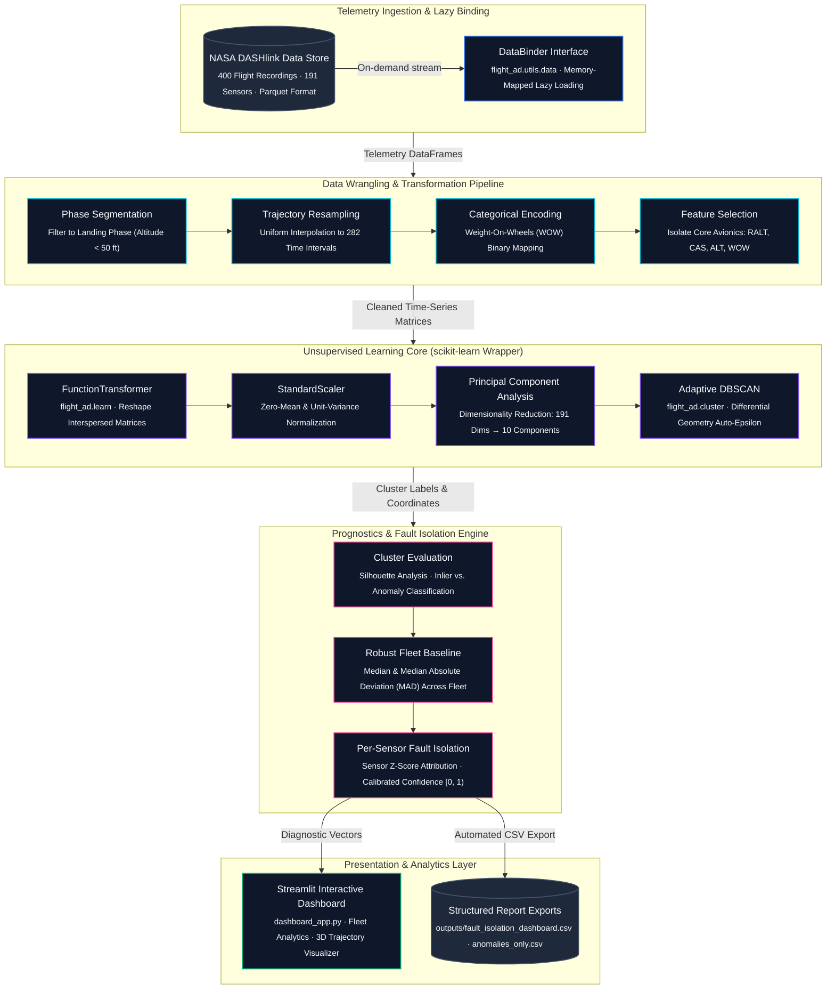

<div align="center">

# Aeroguard

### Unsupervised Aviation Telemetry Anomaly Detection & Fault Isolation Platform

<p>
  
  
  
  
  
</p>

<p>
  
  
  
  
  
</p>

**[Quickstart](#quickstart) &nbsp;·&nbsp; [Architecture](#architecture) &nbsp;·&nbsp; [How It Compares](#how-it-compares) &nbsp;·&nbsp; [Features](#features) &nbsp;·&nbsp; [Tech Stack](#technology-stack) &nbsp;·&nbsp; [Interactive Dashboard](#interactive-dashboard)**

</div>

<br />

## Overview

Most aviation safety monitoring relies on static threshold checks (BITE) that miss subtle multi-parameter degradation. **Aeroguard** is an unsupervised machine-learning platform for early detection and root-cause isolation of soft faults in aircraft flight telemetry. It learns normal landing dynamics directly from fleet history (NASA DASHlink) without manual labels, detects anomalous flights via adaptive manifold clustering, and attributes anomalies down to individual sensors with calibrated confidence scores.

Built on top of [scikit-learn](https://scikit-learn.org), Aeroguard wraps a configurable end-to-end pipeline (data loading, preprocessing, dimensionality reduction, manifold clustering, and diagnostics) into an extensible API.

<br />

### How It Compares

| Dimension | Traditional Avionics (BITE) | Aeroguard Platform |
|---|---|---|
| **Detection Principle** | Static univariate threshold limits | High-dimensional unsupervised manifold learning |
| **Fault Coverage** | Hard limits, gross electrical failures | Subtle soft faults, sensor drift, multi-channel degradation |
| **Parameter Interaction** | Isolated single-sensor analysis | Joint spatial-temporal covariance across 191 avionics sensors |
| **Label Requirement** | Requires historical fault classification | 100% unsupervised — discovers outliers autonomously |
| **Tuning Overhead** | Manual per-fleet epsilon calibration | Differential geometry auto-elbow resolution |
| **Explainability** | Binary fault flags | Per-sensor calibrated confidence attribution & radar diagnostics |

<br />

## Architecture



**End-to-end telemetry flow:** `DataBinder` lazy-loads raw NASA flight parquet files on demand to maintain a minimal memory footprint. The `DataWrangler` pipeline isolates touchdown trajectories, normalises sample rates, and extracts safety-critical features. In the modeling tier, high-dimensional flight matrices are scaled, compressed via PCA, and clustered with custom **Adaptive DBSCAN** (which calculates the optimal $\epsilon$ radius using differential geometry). Detected anomalies are routed to the prognostics engine, which computes robust fleet-level baseline deviations (MAD) to attribute root-cause soft faults to specific aircraft sensors and visualises them in real time via Streamlit.

### Key Technical Contribution: Adaptive DBSCAN

Standard DBSCAN requires manual tuning of the neighbourhood radius `eps`.  Aeroguard eliminates this by computing `eps` automatically:

1. Compute the 2-nearest-neighbour distance for every point.
2. Sort distances in ascending order.
3. Find the point of maximum curvature using differential geometry:
   `κ(x) = |f''(x)| / (1 + f'(x)²)^(3/2)`
4. Use the distance at that elbow as `eps`.

This is implemented in [`flight_ad/cluster/_dbscan.py`](flight_ad/cluster/_dbscan.py).

---

## Features

| Feature | Status |
|---------|--------|
| Unsupervised anomaly detection (no labelled data required) | ✅ |
| Adaptive DBSCAN with automatic `eps` calculation | ✅ |
| Memory-efficient lazy data loading (`DataBinder`) | ✅ |
| Composable preprocessing pipeline (`DataWrangler`) | ✅ |
| sklearn-compatible API (`fit`, `predict`, `fit_predict`) | ✅ |
| Per-sensor fault isolation with confidence scoring | ✅ |
| LRU-cached intermediate results (no redundant computation) | ✅ |
| Interactive Streamlit dashboard with 2D/3D visualisations | ✅ |
| NASA DASHlink dataset integration with auto-download | ✅ |

---

## Technology Stack

| Component | Library | Role |
|-----------|---------|------|
| Core ML | scikit-learn | Pipelines, PCA, StandardScaler |
| Custom clustering | `flight_ad.cluster.DBSCAN` | Adaptive-eps DBSCAN |
| Data processing | pandas, numpy | Time-series manipulation |
| Parquet I/O | pyarrow | Efficient dataset loading |
| Dashboard | Streamlit | Interactive web UI |
| Visualisation | Plotly, matplotlib | Charts and diagnostics |
| Progress | tqdm | Progress bars during processing |

---

## Repository Structure

```
Aeroguard/
├── flight_ad/                    # Core Python package
│   ├── cluster/
│   │   └── _dbscan.py           # Adaptive DBSCAN implementation
│   ├── datasets/
│   │   ├── dashlink.py          # NASA DASHlink data loader (with auto-download)
│   │   └── data.json            # Dataset URL and file manifest
│   ├── learn/
│   │   ├── stats_learner.py     # StatisticalLearner: sklearn pipeline wrapper
│   │   ├── function_estimator.py# FunctionTransformer sklearn estimator
│   │   └── _classifier.py      # ClassifierWrapper utility
│   ├── math/
│   │   └── geometry.py          # Curvature calculation (used by adaptive DBSCAN)
│   ├── pipeline/
│   │   └── ad.py                # AnomalyDetectionPipeline orchestrator
│   ├── reconstruction/
│   │   └── _autoencoder.py      # Autoencoder utilities (experimental)
│   ├── report/
│   │   ├── cluster.py           # Clustering metrics (silhouette, cluster info)
│   │   └── diagnostics.py       # Per-sensor confidence dashboard builder
│   ├── transformations/
│   │   └── transforms.py        # Time-series reshape and resampling utilities
│   ├── utils/
│   │   ├── _sklearn_interface.py# retrieve_partial_pipeline helper
│   │   └── data/
│   │       └── interface.py     # DataBinder lazy-loading data manager
│   ├── viz/
│   │   └── chart.py             # Matplotlib flight and silhouette charts
│   └── wrangling/
│       ├── wrangler.py          # DataWrangler / FunctionPipeline
│       └── operations.py        # Wrangling primitives (resample, impute, etc.)
│
├── examples/
│   ├── sample_dbscan_pipeline.py# Minimal end-to-end example
│   └── wrangling_functions.py   # Wrangling helpers used by demo scripts
│
├── scripts/
│   ├── run_pipeline.py          # Run the pipeline and print results
│   └── generate_reports.py      # Generate CSV reports + fault isolation dashboard
│
├── docs/
│   └── joss/
│       ├── paper.md             # Draft JOSS academic paper
│       └── paper.bib            # Bibliography
│
├── ASSETS/                       # Dashboard screenshots and diagrams
│   └── Pipeline.png
│
├── dashboard_app.py              # Streamlit dashboard application
├── requirements.txt              # Pinned runtime dependencies
├── setup.py                      # Package installation configuration
├── pyproject.toml                # Build system configuration
├── MANIFEST.in                   # Package data manifest
└── LICENSE                       # MIT License
```

---

## Prerequisites

- **Python 3.10+**
- **pip**
- ~1 GB disk space for the NASA DASHlink dataset

---

## Installation

```bash
# 1. Clone the repository
git clone https://github.com/x2ankit/Aeroguard.git
cd Aeroguard

# 2. Create and activate a virtual environment
python -m venv venv
# Windows
venv\Scripts\activate
# macOS / Linux
source venv/bin/activate

# 3. Install dependencies
pip install -r requirements.txt

# 4. Install the package in editable mode
pip install -e .

# 5. Verify
python -c "from flight_ad.pipeline import AnomalyDetectionPipeline; print('OK')"
```

---

## Dataset Setup

Aeroguard uses the **NASA DASHlink** dataset (400 real commercial landing recordings, ~1 GB).

The dataset is **not included in the repository** (binary files, large size).  Download it automatically on first use:

```python
from flight_ad.datasets import load_dashlink_bindings

# Pass download=True on the first run only
bindings = load_dashlink_bindings(download=True)
```

After the download completes the data is stored in `flight_ad/datasets/dashlink_flights/` and subsequent calls work without `download=True`.

Alternatively, download manually from the [NASA DASHlink project page](https://c3.ndc.nasa.gov/dashlink/projects/85/) and extract the parquet files into `flight_ad/datasets/dashlink_flights/`.

---

## Usage

### Launch the interactive dashboard

```bash
streamlit run dashboard_app.py
```

The dashboard requires pre-generated CSV output files.  Run the report generator first (see below).

### Generate CSV reports

```bash
python scripts/generate_reports.py
```

This creates three files in `outputs/`:

| File | Contents |
|------|----------|
| `fault_isolation_dashboard.csv` | Per-flight results with per-sensor confidence scores |
| `anomalies_only.csv` | Subset of anomalous flights only |
| `anomaly_report.csv` | Full dataset with cluster labels and silhouette scores |

### Run a quick pipeline demo

```bash
python scripts/run_pipeline.py
```

Prints progress, metrics, and a ranked list of anomalous flights to the console.

### Custom pipeline in Python

```python
import sys
sys.path.insert(0, "examples")          # for wrangling_functions

from flight_ad.datasets import load_dashlink_bindings
from flight_ad.utils.data import DataBinder
from flight_ad.wrangling import DataWrangler
from flight_ad.pipeline import AnomalyDetectionPipeline
from flight_ad.learn import FunctionTransformer, StatisticalLearner
from flight_ad.cluster import DBSCAN
from flight_ad.transformations import reshape_df_interspersed
from wrangling_functions import preprocess, change_col, resample, select
from sklearn.preprocessing import StandardScaler
from sklearn.decomposition import PCA

data_bindings = load_dashlink_bindings()
binder = DataBinder(data_bindings)

wrangler = DataWrangler([
    ('preprocess_flight', preprocess),
    ('resample_dataframe', resample),
    ('change_col', change_col),
    ('select_col', select),
])

learner = StatisticalLearner({
    'preprocessing': [
        ('reshaper', FunctionTransformer(reshape_df_interspersed)),
        ('scaler', StandardScaler()),
        ('pca', PCA()),
    ],
    'training': [('dbscan', DBSCAN())],
}, record='pca')

pipeline = AnomalyDetectionPipeline(binder, wrangler, learner)
pipeline.fit()

labels = learner.pipeline['dbscan'].labels_
# labels[i] == -1  →  anomaly
# labels[i] >= 0   →  normal cluster id
```

### Key API objects

| Class | Module | Purpose |
|-------|--------|---------|
| `DataBinder` | `flight_ad.utils.data` | Lazy-loads flight recordings on demand |
| `DataWrangler` | `flight_ad.wrangling` | Composable function-based preprocessing pipeline |
| `StatisticalLearner` | `flight_ad.learn` | Wraps a sklearn `Pipeline`; supports intermediate result recording |
| `AnomalyDetectionPipeline` | `flight_ad.pipeline` | Orchestrates binder → wrangler → learner; LRU-caches results |
| `DBSCAN` | `flight_ad.cluster` | Adaptive-eps DBSCAN; extends `sklearn.cluster.DBSCAN` |
| `FunctionTransformer` | `flight_ad.learn` | Wraps an arbitrary function as a sklearn-compatible transformer |

---

## Dashboard Visualisations

After running `generate_reports.py`, the Streamlit dashboard provides:

- **KPI cards**: total flights, anomaly count, anomaly rate, average confidence
- **Cluster distribution** pie chart
- **Anomaly severity** bar chart (HIGH / MEDIUM / LOW by confidence threshold)
- **Per-sensor confidence heatmap** — which sensors deviate most in each anomalous flight
- **Top sensor contributors** aggregate bar chart
- **3D PCA projection** — interactive rotatable scatter of normal vs anomalous flights in principal-component space
- **2D PCA projection** — flattened view with confidence-proportional dot sizes
- **3D sensor parameter space** — RALT × CAS × ALT confidence axes for fault diagnosis
- **Sensor correlation matrix** — which sensors fail together in anomalous flights
- **Anomaly detail table** — sortable per-flight records with top sensor attributions
- **Report snapshot** — preview of the full CSV report

---

## Dataset Details

| Property | Value |
|----------|-------|
| Source | [NASA DASHlink](https://c3.ndc.nasa.gov/dashlink/projects/85/) |
| Number of flights | 400 |
| Sensors per flight | 191 parameters |
| Samples per flight | ~105,000 (at 16 Hz) |
| Flight phase analysed | Landing approach (final ~300 samples to touchdown) |
| After resampling | 282 uniform intervals per parameter |
| Key parameters used | RALT (radar altitude), CAS (calibrated airspeed), ALT (barometric altitude), WOW (weight-on-wheels) |

---

## Current Limitations

- **Dataset dependency**: requires ~1 GB NASA DASHlink download; no streaming support yet.
- **Single data source**: only the DASHlink dataset has an integrated loader; custom datasets require writing a bind function.
- **No model persistence**: trained models live in memory only; there is no built-in save/load mechanism.
- **`viz/chart.py` uses deprecated pandas API**: `DataFrame.append()` was removed in pandas 2.0; the matplotlib chart utilities need updating to `pd.concat()`.
- **No test suite**: the library has no automated tests.
- **Unsupervised baseline only**: no ground-truth labels are available for the DASHlink dataset, so precision/recall cannot be computed.

---

## Future Development

> The following items are **not yet implemented**.

- [ ] Model persistence (pickle / joblib) for trained pipeline checkpoints
- [ ] Real-time streaming mode for live aircraft telemetry
- [ ] REST API for integration with airline ground systems
- [ ] Multi-aircraft cross-fleet pattern recognition
- [ ] LSTM/Transformer anomaly detection as an alternative to DBSCAN
- [ ] pytest test suite covering core pipeline and edge cases
- [ ] Automated CI with GitHub Actions
- [ ] Fix deprecated pandas API in `viz/chart.py`
- [ ] Support for custom dataset schemas beyond DASHlink

---

## Contributing

Contributions are welcome.  Please open an issue to discuss changes before submitting a pull request.  Ensure any new code follows the existing style and that the `examples/` scripts still run correctly.

---

## Attribution

The `flight_ad` Python library is derived from the original open-source project [**flight-ad**](https://github.com/coelhosilva/flight-ad) by Lucas Coelho e Silva, published under the MIT Licence.

The NASA DASHlink dataset is a public dataset provided by NASA:  
> Dario Lbeck, Nikunj Oza, et al. *DASHlink: Data and Algorithm Sharing Hub Link.* NASA Ames Research Center.

---

## License

This project is licensed under the **MIT License** — see the [LICENSE](LICENSE) file for details.